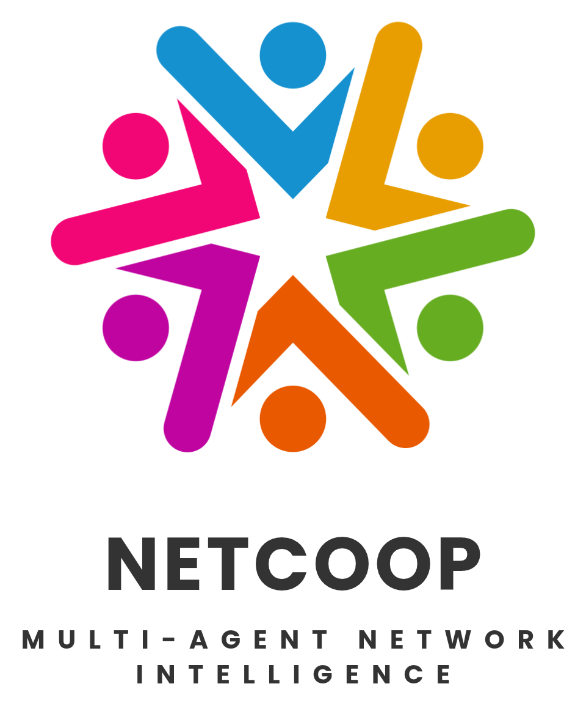

<div align="center">
  
  <h1>NetCoop AI</h1>
  <p><strong>Cooperative Multi-Agent Network Fault Diagnosis, Live Socket Probing &amp; Root-Cause Localization</strong></p>

  <p>
    <a href="https://netcoop.vercel.app/"></a>
    <a href="https://nodejs.org/"></a>
    <a href="https://groq.com/"></a>
    <a href="https://github.com/Sunil56224972/Netcoop"></a>
    <a href="LICENSE"></a>
  </p>

  <p>
    <a href="https://netcoop.vercel.app/"><strong>Launch Live Console (netcoop.vercel.app) &rarr;</strong></a>
  </p>
</div>

---

## Overview

**NetCoop AI** is a cooperative multi-agent network intelligence and fault localization system engineered for enterprise and campus-scale infrastructure (**IIT Bhubaneswar Network Operations**).

Unlike static dashboard monitors that alert on isolated threshold breaches, NetCoop AI runs **six specialized diagnostic agents** over an asynchronous **JSON-RPC v1.0.0 message bus** (`netcoop.agent-message/1.0`). Agents inspect performance, hardware infrastructure, and topological dependencies in parallel, challenge competing hypotheses across time-series windows, enforce strict Section 6 insufficient-evidence guardrails, and synthesize vendor-specific CLI remediation runbooks via **Groq LPU (`openai/gpt-oss-120b`)**.

### Key Capabilities for Real External Users

1. **Live Multi-Target Network & Host Probing (`/api/netcoop/probe-live`)**
   - **Real DNS Resolution Timing**: Executes native OS `dns.lookup()` queries against default or user-specified domains, recording resolution latency (`ms`), resolved IPv4 endpoints, and `NXDOMAIN`/`SERVFAIL` failures.
   - **Real TCP Socket Handshakes**: Opens multi-round `net.Socket()` TCP connections to measure real 3-way handshake RTT (`ms`), inter-round jitter (`ms`), and connection/packet loss (`%`) for any custom `host:port` list entered by the user.
   - **Real Client-Edge Telemetry (`CLIENT_BROWSER_EDGE`)**: Measures the external user's own browser-to-server HTTPS round-trip latency (`performance.now()`), jitter, browser downlink bandwidth (`navigator.connection`), client IP, and edge region.
   - **Real Host OS Counters**: Computes two-point CPU tick deltas (`os.cpus()`) and physical memory utilization (`os.totalmem()` / `os.freemem()`).
2. **Enterprise CSV / TSV Workbench &amp; Arbitrary Telemetry Ingestion (`.csv`, `.tsv`, `.json`, `.ndjson`)**
   - **Multi-Delimiter RFC-4180 CSV Engine**: Paste, upload, or drag-and-drop real exports from SolarWinds, PRTG, Zabbix, Wireshark, PingPlotter, Cisco IOS, ArubaOS, or SNMP pollers — auto-detects comma (`,`), semicolon (`;`), tab (`\t`), or pipe (`|`) delimiters and strips `#` comment headers and UTF-8 BOMs.
   - **Interactive CSV Spreadsheet Grid &amp; Bidirectional `JSON ↔ CSV` Converter**: Inspect tabular columns with live schema-mapping badges (`bw_util` &rarr; `link_utilization_pct`, `uplink` &rarr; `topology.parent`), convert between JSON and CSV in one click, and load multi-tier CSV fault templates.
   - **29-Column CSV Diagnostic Result &amp; Probe Exporter**: Export full per-node diagnostic verdicts, computed averages/peaks across all 16 metrics, anomalous evidence, recommended actions, and CLI runbooks as UTF-8 BOM `.csv` spreadsheets ready for Excel, Pandas, or NOC ticketing systems.
3. **Deterministic 6-Agent Correlation + Two-Pass Challenge Arbitration**
   - When the top two fault hypotheses score within `0.15` of each other or contradicting indicators reach `0.25`, `correlation_agent` issues live JSON-RPC `challenge` envelopes to the specialist agents to verify whether anomalies are sustained across the window or isolated spikes.
4. **Groq LPU &amp; Context-Bound Dynamic CLI Remediation**
   - Synthesizes copy-ready Cisco IOS / ArubaOS / Linux CLI commands via Groq LPU (`openai/gpt-oss-120b`) or context-bound deterministic synthesis referencing the exact root-cause device ID, IPv4 endpoint, upstream parent, and anomalous readings, paired with **Operator Change Control** authorization.

---

## System Architecture

```text
  ┌──────────────────────────────┐     ┌────────────────────────────────────────┐
  │ Live Socket & DNS Probe      │     │ External Telemetry Upload / Paste      │
  │ (dns.lookup + net.Socket +   │     │ (.json / .ndjson / .csv + unit &       │
  │  os.cpus + Client Edge RTT)  │     │  alias normalization)                  │
  └──────────────┬───────────────┘     └───────────────────┬────────────────────┘
                 └────────────────────┬────────────────────┘
                                      ▼
                       ┌──────────────────────────────┐
                       │  Schema & Unit Normalizer    │
                       │   (netcoop.telemetry/1.0)    │
                       └──────────────┬───────────────┘
                                      │
        ┌─────────────────────────────┼─────────────────────────────┐
        ▼                             ▼                             ▼
┌───────────────────┐       ┌───────────────────┐       ┌───────────────────────┐
│ performance_agent │       │infrastructure_agt │       │  connectivity_agent   │
│ Latency, Jitter,  │       │ CPU, RAM, Flaps,  │       │ Topology Blast Radius │
│ Loss, Wi-Fi, Util │       │ CRC Errors, Drops │       │ DNS & DHCP Services   │
└─────────┬─────────┘       └─────────┬─────────┘       └───────────┬───────────┘
          │                           │                             │
          └───────────────────────────┼─────────────────────────────┘
                                      ▼
                    ┌───────────────────────────────────┐
                    │   JSON-RPC v1.0.0 Message Bus     │
                    │  (task / finding / challenge /    │
                    │   challenge_response / result)    │
                    └─────────────────┬─────────────────┘
                                      ▼
                    ┌───────────────────────────────────┐
                    │        correlation_agent          │
                    │  Two-Pass Hypothesis Scoring,     │
                    │  Contradiction Penalty & Gating   │
                    └─────────────────┬─────────────────┘
                                      ▼
                    ┌───────────────────────────────────┐
                    │   reporting_agent + Groq LPU      │
                    │  Section 6 Report + CLI Runbook   │
                    │      (openai/gpt-oss-120b)        │
                    └───────────────────────────────────┘
```

---

## Cooperative Agent Roles

| Agent ID | Role Name | Primary Responsibilities & Monitored Metrics |
| :--- | :--- | :--- |
| `orchestrator` | **Pipeline Orchestrator** | Normalizes telemetry, initializes the JSON-RPC bus, sequences Phases 1–4, and invokes Groq LPU synthesis. |
| `performance_agent` | **Telemetry & Performance Agent** | Evaluates transport and RF health: `latency_ms`, `jitter_ms`, `packet_loss_pct`, `throughput_mbps`, `bandwidth_mbps`, `link_utilization_pct`, `signal_dbm`, `retransmission_pct`. |
| `infrastructure_agent` | **Infrastructure Health Agent** | Evaluates device compute and physical interfaces: `cpu_pct`, `memory_pct`, `queue_drops`, `interface_errors`, `device_status`, `status_flaps`. |
| `connectivity_agent` | **Connectivity & Topology Agent** | Traverses parent/child links to compute `downstream_impact` blast radius and evaluates `dns_latency_ms`, `dns_failure_pct`, `dhcp_latency_ms`, `dhcp_failure_pct`. |
| `correlation_agent` | **Fault Correlation Agent** | Scores 7 canonical fault hypotheses across all nodes, dispatches `challenge` envelopes when top candidates conflict, and computes calibrated confidence. |
| `reporting_agent` | **Recommendation & Reporting Agent** | Enforces Section 6 guardrails (`diagnosed` vs `no_fault_detected` vs `insufficient_evidence` vs `error`) and emits the auditable diagnostic report. |

---

## JSON-RPC v1.0.0 Interoperability Protocol

All inter-agent communication is recorded on the inspectable message bus using the `netcoop.agent-message/1.0` envelope specification:

```json
{
  "protocol": "netcoop.agent-message/1.0",
  "message_id": "M-0005",
  "run_id": "R-1730662000000-1",
  "seq": 5,
  "timestamp": "2026-11-04T01:15:10.112Z",
  "from": "correlation_agent",
  "to": "performance_agent",
  "type": "challenge",
  "in_reply_to": null,
  "summary": "Challenge to performance_agent: re-check 3 readings",
  "payload": {
    "challenge_id": "C-1",
    "reason": "Link congestion (0.82) and Device resource overload (0.71) are too close to separate on first reading",
    "question": "Is each reading sustained across the recent window, or only a spike?",
    "requests": [
      { "device_id": "HOSTEL_CORE_SW_01", "metric": "link_utilization_pct" },
      { "device_id": "HOSTEL_CORE_SW_01", "metric": "latency_ms" }
    ]
  }
}
```

### Protocol Execution Phases

1. **Phase 1 — Observation (`task` &rarr; `finding`)**: `performance_agent` and `infrastructure_agent` evaluate time-series windows (baseline vs recent 30% window) on every node.
2. **Phase 2 — Topology & Scope (`task` &rarr; `finding`)**: `connectivity_agent` maps upstream/downstream relationships, identifies impaired subtrees, and evaluates DNS/DHCP service metrics.
3. **Phase 3 — Correlation & Challenge (`challenge` &rarr; `challenge_response`)**: `correlation_agent` ranks `(hypothesis, device)` pairs and challenges owning agents if the top two candidates are within `0.15` or contradiction reaches `0.25`.
4. **Phase 4 — Synthesis (`result`)**: `reporting_agent` compiles the Section 6 report and `groq.js` synthesizes the vendor CLI remediation runbook.

---

## Mathematical Scoring & Guardrail Formulation

Implemented deterministically in [`src/analysis.js`](src/analysis.js):

1. **Indicator Degree of Anomaly ($\delta \in [0, 1]$)**:
   - $\delta = 0$ below Warning threshold ($W$).
   - $\delta = 0.5 + 0.5 \times \text{clamp}\left(\frac{x - W}{C - W}, 0, 1\right)$ between Warning ($W$) and Critical ($C$).
2. **Hypothesis Score ($S$)**:
   $$\text{ratio} = \frac{\sum w_i \cdot \delta_i}{\sum w_i}, \quad \text{contradiction} = \frac{\sum w_c \cdot \delta_c}{\sum w_c}$$
   $$S = \max\left(0,\ \text{ratio} - 0.35 \times \text{contradiction}\right)$$
   *(Capped at `0.20` unless at least one primary indicator for the hypothesis reaches $\delta \ge 0.50$).*
3. **Calibrated Confidence ($C$)**:
   $$C_0 = S \times (0.55 + 0.45 \times \text{coverage}) \times \left(0.75 + 0.25 \times \min\left(1, \frac{\text{margin}}{0.30}\right)\right)$$
   $$C = \min\left(0.95,\ C_0 \times (0.70 + 0.30 \times \text{adequacy})\right)$$
4. **Section 6 Insufficient-Evidence Guardrail**:
   - If $S < 0.40$ or $\text{coverage} < 0.35$, or if no anomalies are observed across fewer than 3 of the 7 core metric families, the system outputs `status: "insufficient_evidence"` rather than guessing a root cause.

---

## Canonical Metrics & Threshold Matrix

| Metric Key | Unit | Valid Range | Warning ($W$) | Critical ($C$) | Owning Agent |
| :--- | :---: | :---: | :---: | :---: | :--- |
| `latency_ms` | `ms` | `0 – 60,000` | `50 ms` | `150 ms` | `performance_agent` |
| `jitter_ms` | `ms` | `0 – 60,000` | `15 ms` | `40 ms` | `performance_agent` |
| `packet_loss_pct` | `%` | `0 – 100` | `1 %` | `5 %` | `performance_agent` |
| `throughput_mbps` | `Mbps` | `0 – 1,000,000` | informational | informational | `performance_agent` |
| `bandwidth_mbps` | `Mbps` | `0 – 1,000,000` | informational | informational | `performance_agent` |
| `link_utilization_pct` | `%` | `0 – 100` | `75 %` | `90 %` | `performance_agent` |
| `signal_dbm` | `dBm` | `-120 – 0` | `-67 dBm` | `-78 dBm` | `performance_agent` |
| `retransmission_pct` | `%` | `0 – 100` | `8 %` | `20 %` | `performance_agent` |
| `cpu_pct` | `%` | `0 – 100` | `75 %` | `90 %` | `infrastructure_agent` |
| `memory_pct` | `%` | `0 – 100` | `80 %` | `92 %` | `infrastructure_agent` |
| `queue_drops` | `pkt` | `0 – 10^12` | `20 pkt` | `100 pkt` | `infrastructure_agent` |
| `interface_errors` | `err` | `0 – 10^12` | `10 err` | `80 err` | `infrastructure_agent` |
| `dns_latency_ms` | `ms` | `0 – 60,000` | `80 ms` | `250 ms` | `connectivity_agent` |
| `dns_failure_pct` | `%` | `0 – 100` | `2 %` | `10 %` | `connectivity_agent` |
| `dhcp_latency_ms` | `ms` | `0 – 60,000` | `200 ms` | `800 ms` | `connectivity_agent` |
| `dhcp_failure_pct` | `%` | `0 – 100` | `2 %` | `10 %` | `connectivity_agent` |

---

## Web Console Workspace (`public/`)

Accessible live at **[https://netcoop.vercel.app/](https://netcoop.vercel.app/)**:

1. **System Runtime (`#tab-boot`)**
   - Displays the NetCoop identity card, 6-agent readiness status, 4 live hardware/network KPI cards (`Host Gateway Node`, `Host CPU & Memory`, `Live Target RTT / DNS`, `Latest Verdict`), the **Live Probed Network Targets & Local Host Gateway** table (including `CLIENT_BROWSER_EDGE` browser-to-edge RTT and click-to-inspect raw time-series samples), and a live runtime event log.
2. **Live Diagnostics (`#tab-studio`)**
   - **Live Network Target Prober**: Enter any custom domain, IP, or `host:port` list (or click preset target groups) to measure real DNS + TCP socket telemetry and diagnose immediately.
   - **Telemetry Payload Editor**: Paste, edit, format, download, or upload/drag-and-drop custom `.json`, `.ndjson`, or `.csv` network telemetry.
   - **8 Benchmark Fault Scenarios**: Single-click campus fault presets (`normal`, `link_congestion`, `weak_wifi`, `interface_fault`, `dns_failure`, `dhcp_failure`, `interop_failure`, `device_overload`).
   - **Diagnostic Verdict & Evidence Suite**: Displays root-cause verdict, calibrated confidence, **Per-Node Telemetry Summary**, **Supporting Telemetry Evidence**, **Groq LPU CLI Remediation Runbook**, **Operator Change Control** sign-off, **Hypothesis Cause Ranking**, and raw Section 6 JSON export.
3. **Network Topology (`#tab-topology`)**
   - Dynamically computes tree depth from `topology.links` or device `parent`/`uplink` declarations to render a multi-tier hierarchical **SVG Dependency Graph**, node health cards, and the **Topology Link Adjacencies** table.
4. **Agent Message Bus (`#tab-bus`)**
   - Live filterable stream of all JSON-RPC v1.0.0 agent envelopes (filter by agent ID, envelope type, or full-text search) with a raw JSON-RPC envelope inspector modal and `.json` export.
5. **Protocol Spec (`#tab-protocol`)**
   - Live specification reference rendered from `/api/netcoop/protocol` detailing all 6 agent contracts, 4 scoring weights, 4 state-machine phases, and 16 canonical metric thresholds.
6. **Command Palette (`/` or `Ctrl+K`)**
   - Instant keyboard navigation across live probe actions, tabs, fault scenarios, and monitored node inspectors.

---

## REST API Reference

### `POST /api/netcoop/probe-live` (or `GET /api/netcoop/probe-live`)
Actively probes real DNS resolution latency, multi-round TCP socket handshake RTT, jitter, packet loss, and host CPU/RAM counters, optionally running the full 6-agent diagnostic pipeline.

```bash
curl -X POST https://netcoop.vercel.app/api/netcoop/probe-live \
  -H "Content-Type: application/json" \
  -d '{
    "targets": "1.1.1.1:443, 8.8.8.8:443, github.com:443, api.groq.com:443",
    "diagnose": true,
    "samples": 5,
    "interval": 45
  }'
```

### `POST /api/netcoop/diagnose`
Run a full cooperative 6-agent diagnosis on any JSON, NDJSON, or CSV telemetry payload.

```bash
curl -X POST https://netcoop.vercel.app/api/netcoop/diagnose \
  -H "Content-Type: application/json" \
  -d '{
    "telemetry": {
      "schema": "netcoop.telemetry/1.0",
      "devices": [
        { "id": "CORE_RTR_01", "type": "core_router" },
        { "id": "DIST_SW_02", "type": "distribution_switch", "parent": "CORE_RTR_01" }
      ],
      "samples": [
        { "device_id": "DIST_SW_02", "link_utilization_pct": 96.4, "queue_drops": 185, "latency_ms": 142, "packet_loss_pct": 4.2 }
      ]
    }
  }'
```

### `GET /api/netcoop/scenarios` & `GET /api/netcoop/scenarios/:key`
List or generate telemetry for any of the 8 built-in campus benchmark scenarios.

### `GET /api/netcoop/protocol`
Return the JSON-RPC v1.0.0 protocol schema, scoring weights, and agent role definitions.

---

## Quickstart & Local Development

### 1. Clone & Install
```bash
git clone https://github.com/Sunil56224972/Netcoop.git
cd Netcoop
npm install
```

### 2. Environment Configuration (Optional Groq API Key)
Create a `.env` file in the project root:
```env
NETCOOP_PORT=4000
NETCOOP_GROQ_KEY=gsk_your_groq_api_key_here
NETCOOP_GROQ_MODEL=openai/gpt-oss-120b
```
*(If `NETCOOP_GROQ_KEY` is omitted, the deterministic 6-agent engine and heuristic CLI synthesizer run automatically without external dependencies.)*

### 3. Run Web Server, CLI, or MCP Server
```bash
# Start web server on http://localhost:4000
npm start

# Run CLI diagnostics on a scenario or custom telemetry file
npm run cli -- --scenario link_congestion
npm run cli -- --scenario weak_wifi --json

# Launch JSON-RPC 2.0 Model Context Protocol (MCP) server over stdio
npm run mcp
```

---

## Automated Verification Suite

Run the 7-stage verification suite covering protocol schema, JSON/CSV/NDJSON normalization, all 8 campus fault scenarios, insufficient-evidence guardrails, Section 6 schema compliance, and live host/network probing:

```bash
npm test
```

```text
======================================================
   NetCoop AI — Automated Test Suite
======================================================

[1/7] Verifying Protocol Schema & Metadata...
  ✓ Protocol v1.0.0 and 16 metric definitions verified

[2/7] Testing Telemetry Input Normalization...
  ✓ JSON telemetry parsed correctly
  ✓ CSV telemetry parsed correctly

[3/7] Testing Scenario Registry...
  ✓ Loaded 8 built-in test scenarios

[4/7] Running Multi-Agent Diagnosis on all 8 Scenarios...
  • normal               -> no_fault_detected  [90%] | No fault detected: all reported metrics are normal
  • link_congestion      -> diagnosed          [95%] | Likely link congestion on HOSTEL_CORE_SW_01
  • weak_wifi            -> diagnosed          [88%] | Likely weak Wi-Fi signal at STUDENT_LAPTOP_14
  • interface_fault      -> diagnosed          [65%] | Likely physical or interface fault on DEPT_CS_SW_02
  • dns_failure          -> diagnosed          [95%] | Likely DNS resolution failure or slowness seen at CAMPUS_DNS_01
  • dhcp_failure         -> diagnosed          [60%] | Possible DHCP failure or slowness seen at CAMPUS_DHCP_01
  • interop_failure      -> error              [0%]  | Input validation failed: Incompatible schema version
  • device_overload      -> diagnosed          [95%] | Likely resource overload on IITBBS_CORE_SW_01

[5/7] Testing Guardrails (Must not claim exact root cause with insufficient evidence)...
  ✓ System correctly reports no false alarms when telemetry is clean/sparse

[6/7] Verifying Exact Section 6 Output Schema Compliance...
  ✓ Report schema precisely satisfies Problem Statement Section 6 specifications

[7/7] Testing External Arbitrary Telemetry & Live Host Probing...
  ✓ Live host network probe captured 20 real measurements
  ✓ Arbitrary external CSV with custom devices diagnosed with real computed evidence
  ✓ Arbitrary external NDJSON normalized and unit-converted without canned responses

======================================================
   ALL NETCOOP TESTS PASSED SUCCESSFULLY (100%)
======================================================
```

---

## License

Released under the [MIT License](LICENSE).
